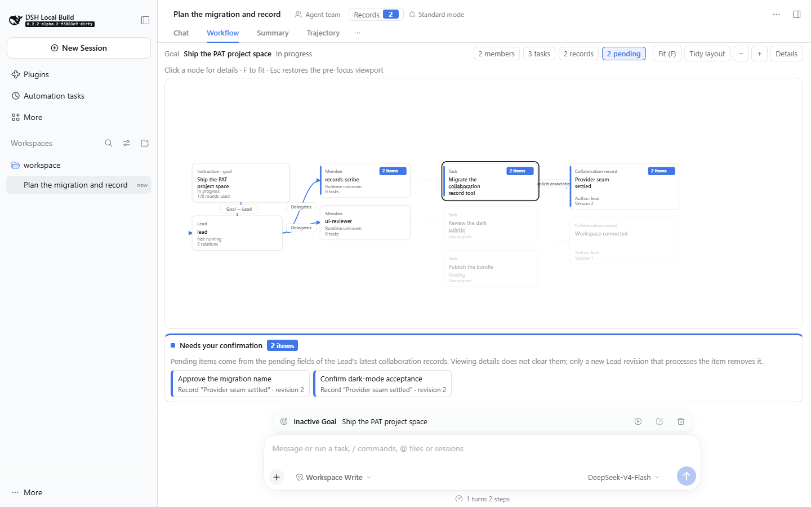
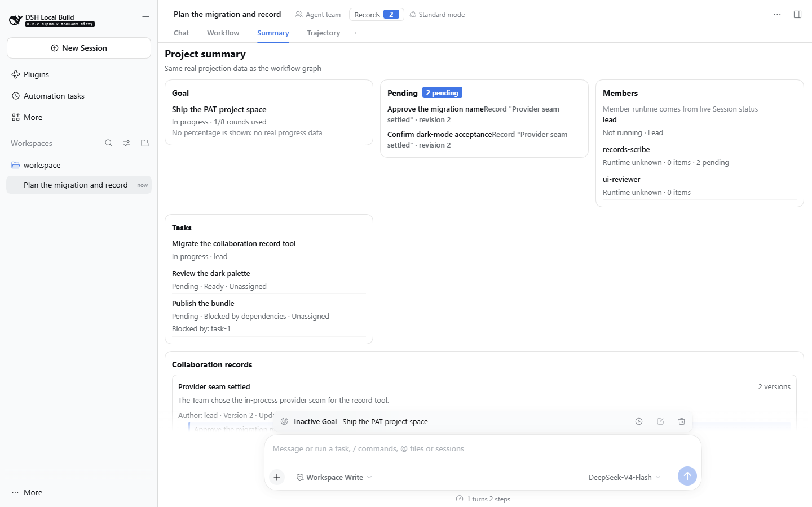
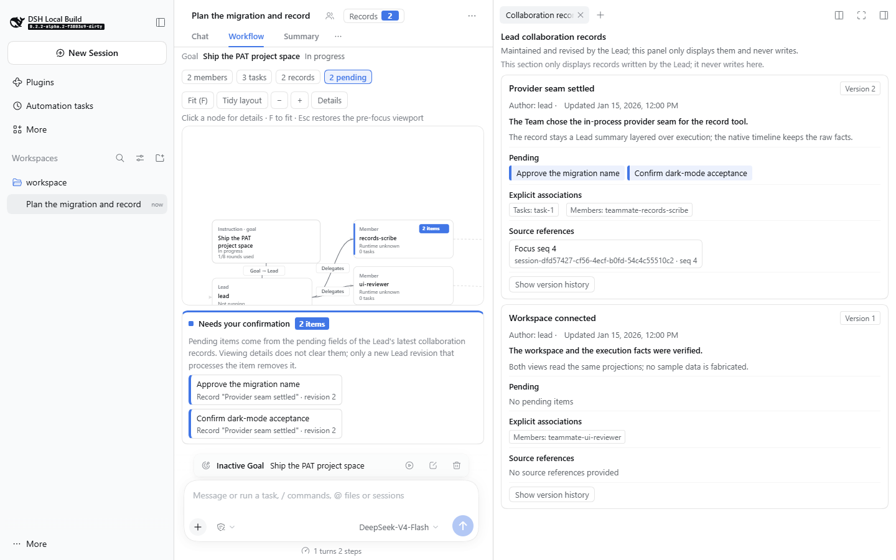
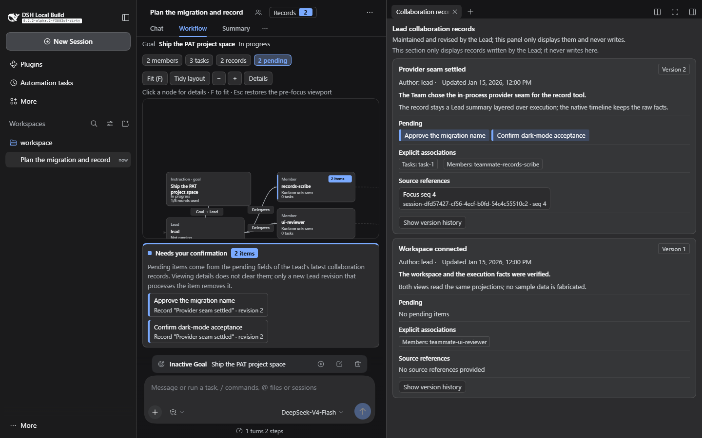

# dsh-agent-panel

面向 DSH 会话的项目空间界面。注册两个会话视图（工作流、项目摘要），并在原生右侧栏提供协作记录页签。数据取自当前会话已有的 Team、Goal 与记录状态，不设独立任务存储。



*图 1：工作流视图。目标、Lead、成员、任务与结果位于同一视图；每个成员对应一个委派入口。*

## 1. 目标与约束

DSH 的 Agent Team 在单个会话内并行执行多个任务。任务、成员状态、交付结果与人工决定分别保存在不同来源，缺乏统一的呈现位置。本插件将上述对象组织为一个可导航的工作流视图、一个可快速浏览的摘要视图，以及一个由 Lead 维护的版本化协作记录面板。

设计约束如下：

1. 视图只读取既有会话数据；不建立第二套任务或成员存储。
2. 原生执行事实与人工整理内容分离。任务完成状态不表示人工验收通过；Lead 记录的结论不覆盖原始事件。
3. 存在性不确定的状态（成员运行状态、任务归属、引用位置）显式标记为未知或未提供，不做推断。
4. 不引入原生代码修改。所有界面均通过 DSH 插件扩展点注册。

## 2. 界面组成

### 2.1 工作流视图

工作流视图为会话内的一个独立视图，与 Chat、Trajectory 并列。图节点分为五类：目标（原生 Goal）、Lead、成员、任务、结果（协作记录）。边包括：目标→Lead、Lead→成员（每个成员单一委派入口）、成员→任务、任务/成员→结果。结果与任务、成员之间的边仅由记录中显式给出的标识产生，不按时间或成员名推断。

交互包括节点与边的选取、详情侧栏、`F` 全览、`Esc` 恢复聚焦前视口、显式重新布局、节点拖拽。订阅更新只放置新增节点，不重排既有布局。节点位置与视口按会话保存在浏览器本地存储。



*图 2：项目摘要视图。与工作流视图使用同一数据来源，按目标、待确认、成员、任务、记录分区呈现。*

### 2.2 项目摘要视图

摘要视图为第二个独立注册的会话视图，不构成工作流视图内的模式切换。分区包括：目标、待确认事项、成员（含运行状态）、任务（含状态与阻塞关系）、协作记录摘要。

### 2.3 协作记录面板

协作记录以页签形式注册到原生右侧栏，由会话头部的记录入口打开，入口显示当前待确认数量。面板内容只读，包含：作者、修订号、更新时间、待确认事项、显式关联的任务与成员、来源引用、完整版本历史。

进入详情、切换视图或关闭/重新打开面板均不改变待确认状态；仅当 Lead 写入的新修订不再包含某待确认项时，该项从面板与计数中移除。



*图 3：右侧栏协作记录面板。记录带有修订号、作者、显式关联与来源引用。*

## 3. 数据与状态语义

本插件的显示对象来自以下来源：

- Team 成员与任务：来自 Lead 会话的 Team 状态；
- 目标：来自会话的原生 Goal 状态；
- 成员运行状态：来自对应成员会话的实时状态字段；
- 协作记录：来自 Lead 写入的、带版本的记录事件；记录含有作者、修订号、显式关联与来源引用。

状态语义按以下规则处理：

- Agent 运行状态、任务状态、人工结论三者分开展示，不互相替代。
- 团队未启用或数据缺失时，相关区域显示明确的缺失或未知状态；不注入示例数据。
- 不生成进度百分比。任务完成数量与实际验收数量分别计算。
- 来源引用指向 `(sessionId, seq)`；引用是否可见取决于对应会话是否可访问及事件窗口是否已加载。

## 4. 视觉规范

- 浅色主题：白色卡片、石墨色文字、蓝色提示；不使用琥珀色或黄色背景配棕色文字，不使用数字序号分栏。
- 深色主题为独立配色方案，通过语义化主题变量实现，不采用反色或滤镜生成。
- 待确认状态以蓝色实心角标、左侧边线、文字与数量共同表示；选中状态使用独立外轮廓。两者互不覆盖。
- 默认字号下正文可读；顶部区域保持紧凑，画布占据主要空间；详情置于按需侧栏。
- 视口宽度 1440 与 768 下，界面不产生页面级横向滚动。



*图 4：深色主题下的同一面板。*

## 5. 集成与安装

本插件以 DSH 插件形式运行，不修改 DSH 原生代码：

- 两个视图通过 `conversation.view` 扩展点注册；
- 记录页签通过原生右侧栏的页签注册接口注册，面板内容注册在对应的侧栏内容位；
- 记录入口注册在会话头部的操作位；
- 数据读取使用客户端既有的 Session 状态与投影接口；不新增远程读接口，不建立并行状态。

前置条件：

- DSH 0.2.1 及以上的 Web 或桌面 profile；
- 已启用 Agent Teams（`@deepseek-ai/dsh-experimental-agent-team-profile`）；
- Node.js 24。

安装脚本做两件事：把两个构建产物复制到 `<profile>/node_modules/@deepseek-ai/`；在 `<profile>/cordis.patch.yml` 末尾追加一段带标记的 loader 行，指向这两个包的 `lib/index.js`。脚本会先备份 profile patch，重复执行时替换旧标记块，不启动或重启宿主。默认拒绝 live desktop profile，需要显式传入 `--allow-desktop`。

```powershell
git clone https://github.com/r05En1cU/dsh-agent-panel.git
cd dsh-agent-panel
node install-into-profile.mjs --profile "<profile 目录>"
# 桌面 profile 需显式允许：
# node install-into-profile.mjs --profile "%USERPROFILE%\.dsh\profiles\desktop" --allow-desktop
# 重启 DSH 宿主后生效
```

卸载脚本删除标记块与两个包目录，并在写入前备份 profile patch：

```powershell
node uninstall-from-profile.mjs --profile "<profile 目录>"
```

## 6. 验证状态

在 Windows 环境下，以 DSH `0.2.2-alpha.2` 源码构建的 Web 组合完成验证：

| 项目 | 结果 |
| --- | --- |
| 构建（8 个构建门） | 8/8 通过 |
| 类型检查（Host 与 Client 两个聚合项目） | 2/2 通过 |
| 相关测试（Host、Client、Trajectory、Stats、Profile） | 86 个文件 / 1430 项通过 |
| 真实浏览器端到端测试（含真实 Host 与记录写入） | 刷新模式 12/12，回放模式 12/12 |
| 浅色/深色、1440/768 截图 | 12 张 |

另在已安装的 DSH 桌面运行时（0.2.1-rc.5）验证插件加载：插件出现在浏览器启动清单中，页面无脚本错误、无控制台错误、无失败请求。该验证仅覆盖加载与渲染，不包含完整交互回归。

## 7. 已知限制

1. 默认视图仍为 Chat。工作流与摘要需通过视图页签切换；未提供默认视图覆盖。
2. 同会话内的来源引用不能定位到具体事件。当前无原生接口支持跨组件的事件序号定位，面板对同会话引用显示明确提示；跨会话引用仅打开来源会话。
3. 团队未启用时，工作流视图停留在加载状态，未呈现完整的未启用空态。原因是相关投影单元缺失时客户端状态无法收敛。
4. 任务归属按 `ownerName` 精确匹配成员名；任务视图不提供 `ownerId`。名称缺失或重复时，不建立归属边并显示未分配。
5. 记录以实验性插件记录形式持久化。该类记录可被不识别它的读取方忽略；未来会话格式迁移仅尽力保留，不提供强保证。
6. 未提供读取记录的模型工具。Lead 通过写入工具返回的修订号继续修订。
7. 浅色主题下部分次要文本的对比度低于 WCAG AA：49 个采样中 12 个低于 4.5:1，最低 3.71:1。深色主题最低 6.53:1，中位数 9.25:1。
8. 布局与视口仅在浏览器本地按会话保存，不跨设备同步。
9. 不包含个人记忆或行为画像；不包含跨会话的 Goal 事务、任务调度或人工验收工作流。

## 8. 仓库结构

```text
packages/
  dsh-experimental-collaboration-records/   Host 插件（lib/index.js）
  dsh-experimental-client-ui-project-space/ 浏览器插件（lib/index.js、lib/client.js）
docs/screenshots/project-space/             README 图示
install-into-profile.mjs                    安装到指定 DSH profile
uninstall-from-profile.mjs                  卸载
package.json                                仓库元数据与本地脚本
BUILD-PROVENANCE.md                         构建来源与哈希
```

## License

MIT