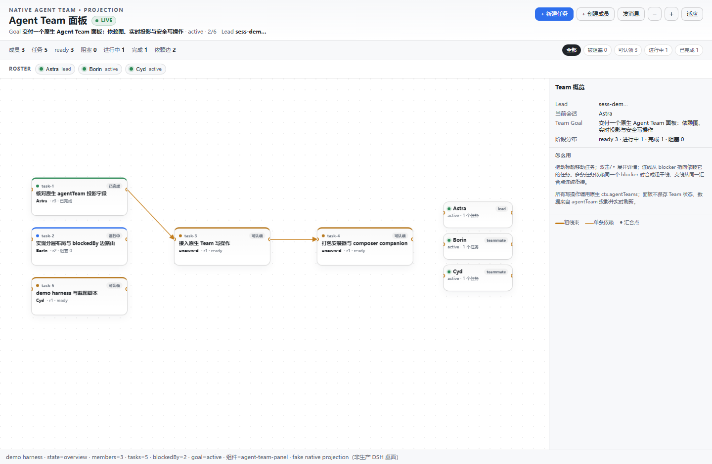
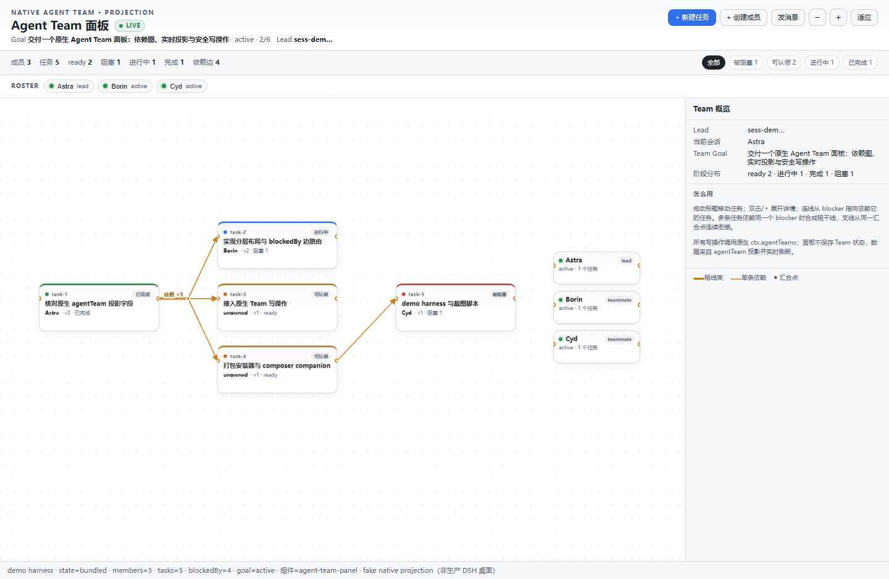
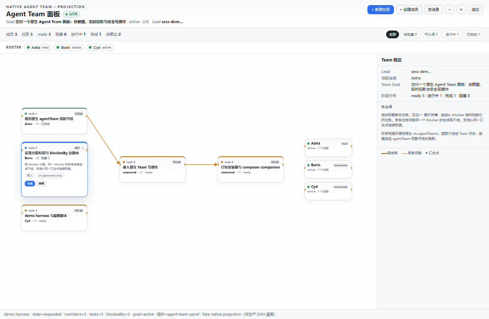
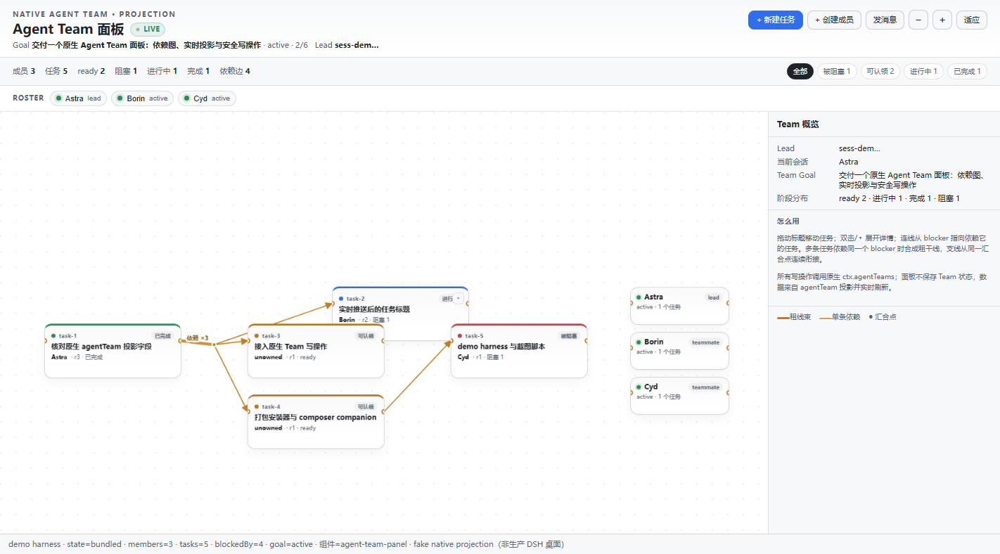
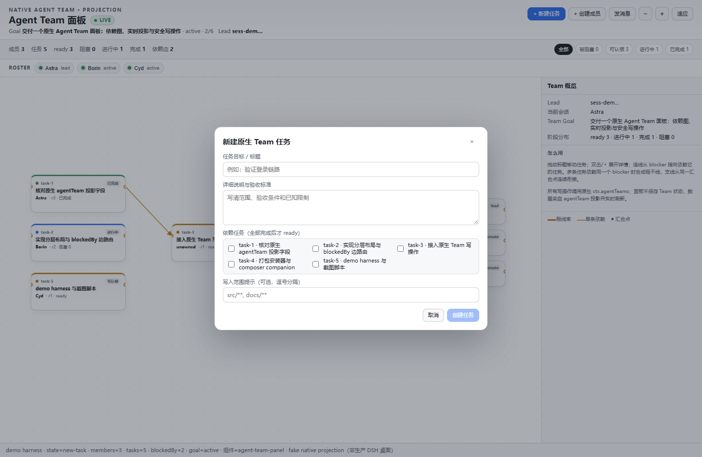
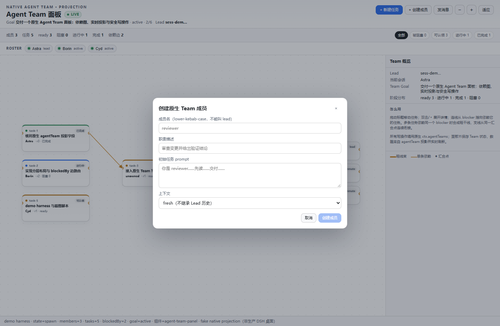
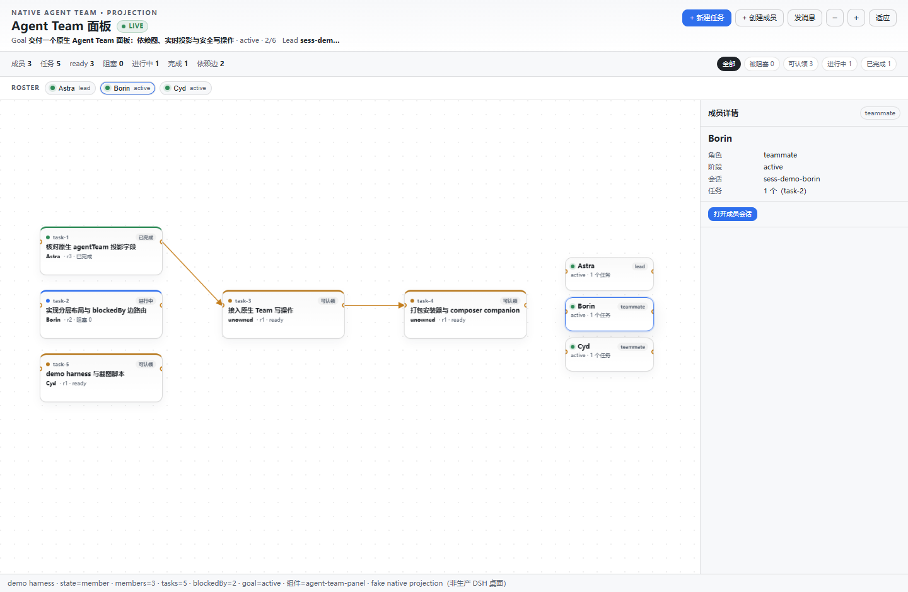

# dsh-agent-panel

**DSH 原生 Agent Team 的节点-边面板。** 读取 Lead Session 的 native `agentTeam` 投影，实时画任务/成员图；节点可拖动、展开，依赖线跟随；同一 blocker 的多条依赖自动合成粗干线，细支线从同一汇合点连续衔接；写操作直接调用原生 `ctx.agentTeams`，不引入第二套任务存储。

> 状态：**源码候选；已安装到 desktop profile（2026-10-29 13:10 UTC），待重启生效**。已在隔离浏览器 harness + 真实构建产物上完成 71 项测试、7 张面板截图与 5 项 Chrome CDP 交互检查；**未重启 GUI、未调用真实模型**。DSH 目标版本 **0.2.1-rc.3**。安装/回退细节见 [docs/DESKTOP-INSTALL.md](docs/DESKTOP-INSTALL.md)。
>
> 截图来自隔离 demo harness（真实 `client.js` + 真实 React + 伪造 native projection），底部状态条明确标注；不是生产桌面截图。

## 1. 它解决什么

原生 Agent Team 的 header 面板是 roster + 任务卡列表；任务之间的 `blockedBy` 只是一段文本。项目把同一份原生投影做成一个**可操作的节点-边面板**：

- **实时**：订阅 `sessions.list` 的原生 projection，Team 一变就重绘；不轮询、不复制状态。
- **移动/展开**：拖动任务卡；双击或 ▾ 原地展开详情。连线按真实 DOM 端口测量，节点移动/展开后自动跟随。
- **粗线束**：同一 blocker 的多条 `blockedBy` 先汇到 junction，再分成细支线；trunk 无箭头、支线箭头指向 dependent，汇合点连续无缝。
- **原生写操作**：新建/认领/完成/释放/重开/编辑/分配/删除任务，创建 teammate，发送消息——全部走 Host exact route → `ctx.agentTeams`，权限由当前 live Agent 的原生 Team 角色判定。
- **目标/阶段绑定**：Team 级 `goal` projection 显示 objective/phase/rounds；每个任务显示派生的阶段（blocked/ready/active/done）和 owner/target 绑定，点击 owner 打开成员会话。
- **composer 折叠 companion**：保留主输入框折叠功能，作为同仓库 companion 一起安装，不混入面板状态。

## 2. 界面

### 2.1 总览与实时投影

### 2.2 粗线束：trunk + branches

同一 blocker 的 3 条依赖：

- 粗 trunk：宽度 `min(8, 2.8 + 1.1 × (count - 1))`
- 细 branch：1.8px，带箭头
- trunk 终点与所有 branch 起点使用**同一个 junction 坐标**，不出现粗线断开/细线漂移
- 单条依赖不合并，保持普通细线

### 2.3 节点展开：线跟随

展开增加节点高度、重排层级；端口按 DOM 实测，连线在同一帧跟随。

拖动 + 实时投影推送（真实 headless Chrome，CDP 驱动）：

- task-2 从 `left=376px/top=32px` 拖到 `left=518.879px/top=89.1518px`；对应 blockedBy branch 的 `d` 同步变化。
- trunk 终点与三条 branch 起点均为 `319.607 187.653`（拖动后重新计算 junction，仍完全一致）。
- 同页执行 `sessions.update(fixture)` 模拟 native projection push，标题从原任务变为「实时推送后的任务标题」，无刷新。

### 2.4 原生任务创建

依赖任务多选；提交调用 `createTask`，不写本地 Team 状态。

### 2.5 原生 teammate 创建

仅 Lead 可创建（按钮按 `canSpawn` 禁用）；provider 按 `fresh → spawn` / `fork → fork` 选择。

### 2.6 成员检查器与 target 绑定

### 2.7 composer 折叠 companion

主输入框折叠为单行条、保留原生发送按钮；完整行为见 [companions/composer-compact/README.md](companions/composer-compact/README.md)。截图裁剪自 companion 的隔离 rc.3 验证归档（本轮未重跑），仅展示收起的输入条。

## 3. 数据流与边界

~~~text
native Lead Session
  └─ sessionProjections: agentTeam (stateVersion 4) + goal
       └─ sessions.list snapshot ── subscribe ──▶ client panel
                                                    │
                                                    ├─ normalizeTeamView / buildTeamGraph
                                                    ├─ layoutTeamGraph / routeTeamEdges
                                                    └─ drag / expand / inspector / modal

panel action ── POST /api/agent-team-panel.* ──▶ host exact route
                                                └─ ctx.agents.get(sessionId)
                                                   └─ ctx.agentTeams.{createTask,updateTask,spawnTeammate,sendMessage}
~~~

- **读**：浏览器只读 native projection；Host 没有额外 state GET，也没有第二份持久化。
- **写**：四条 exact POST route，caller = 当前 session 的 exact live Agent；不会静默替换成 Lead。
- **目标**：Team 级 goal projection；任务目标 = 原生 `subject`，阶段由 `status + ready + blockedBy` 派生。
- **不做的**：不消费/不迁移任何独立任务库，不改原生日志格式，不把任务写进 session 日志；没有 Team projection 时展示空态。

## 4. 安装

前置：DSH 0.2.1-rc.3 的 Web profile，Node 24。

~~~powershell
git clone https://github.com/r05En1cU/dsh-agent-panel.git
cd dsh-agent-panel
node scripts/build-client.mjs
node install-into-profile.mjs --profile "<profile 目录>"
# 重启或刷新宿主；脚本本身不启动/重启/杀死宿主
~~~

安装会做两件事：把 `dsh-plugin-agent-team-panel` 与 `dsh-plugin-composer-compact` 放到 profile 的 `node_modules`；在 `cordis.patch.yml` 追加两条带标记的 insert 块。默认拒绝 live desktop profile，必须显式 `--allow-desktop`；支持 `--link` / `--dry-run`，重复运行幂等。

回退：

~~~powershell
node uninstall-from-profile.mjs --profile "<profile 目录>"
~~~

详见 [docs/INSTALL.md](docs/INSTALL.md) 与 [docs/DESKTOP-INSTALL.md](docs/DESKTOP-INSTALL.md)。

## 5. 开发与验证

~~~powershell
node scripts/build-client.mjs
node --test --test-concurrency=1 --test-timeout=30000 "test/*.test.mjs"
node demo/selfcheck.mjs
node scripts/shoot.mjs
node scripts/cdp-check.mjs
~~~

| 范围 | 结果 |
|---|---|
| host routes（4 条 POST、参数/权限/错误映射/注册清理） | 37/37 |
| model（native wire 规范化、stage/goal/target 绑定） | 15/15 |
| geometry（分层、trunk/branch 连续性、实测端口、移动/展开） | 16/16 |
| built client（ModuleLoader、注册、projection 读取、打包函数） | 3/3 |
| 合计 | **71/71 pass** |
| 浏览器 demo | 7 张真实 headless Chrome 截图 |
| CDP 交互 | 5/5（挂载、拖动、branch 跟随、trunk/branch 连续性、projection 实时更新） |

- 截图脚本：[scripts/shoot.mjs](scripts/shoot.mjs)（本地静态服务器 + Chrome headless；不访问网络）。
- demo harness：[demo/index.html](demo/index.html)；fake native projection 在 [demo/fixtures.mjs](demo/fixtures.mjs)。
- 数据/几何契约：[docs/GRAPH-MODEL.md](docs/GRAPH-MODEL.md)；Host API：[docs/HOST-API.md](docs/HOST-API.md)；逐项结果与限制：[docs/VERIFICATION.md](docs/VERIFICATION.md)。

## 6. 已知限制

- 不是生产 desktop/CU 视觉签收；demo 使用合成 native projection，截图底部有隔离说明。
- 写操作需要当前 session 的 live Agent；页面在 agent 未加载时会收到 `AGENT_NOT_LOADED`，不会伪造 caller。
- 原生 projection 失败时面板显示失败 banner，不尝试恢复/重建 Team。
- 视觉端口测量依赖 `ResizeObserver`；不支持时退回盒子锚点（仍能跟随，但精度较低）。
- 暗色主题、窄屏触控、超大图（>100 任务）和真实帧率未系统验证；布局是确定性分层，不是力导向。
- composer companion 是独立 package；截图来自历史验证归档，本轮未重跑其 59 项。

## 7. 目录

~~~text
index.mjs                  host half: exact owner routes -> ctx.agentTeams
src/host-routes.mjs        native service route handlers
src/model.mjs              native projection -> tasks/members/stages/goal
src/geometry.mjs           layered layout + trunk/branch routing
src/client-body.js         React panel, drag/expand/live/inspector/modals
scripts/build-client.mjs   concatenates the browser half -> client.js
scripts/shoot.mjs          isolated demo + headless screenshots
companions/composer-compact/  preserved composer-collapse plugin
demo/                      zero-build browser harness + fixtures
docs/                      contract, graph model, host API, install
test/                      node:test suites
~~~

## 8. License

MIT。composer companion 保留其原始 MIT 许可与行为。
